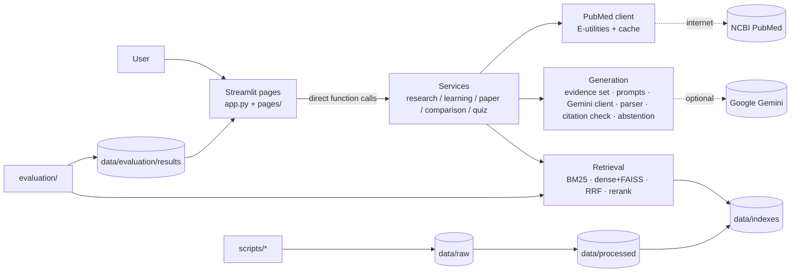

# 🧬 BioMentor AI

**Evidence-Grounded Biomedical Research and Learning Assistant** - a local, Streamlit-only RAG application that searches biomedical literature (PubMed), explains topics at a level you choose, and always shows the sources behind what it says.

> Educational and research use only. BioMentor does not diagnose, interpret personal symptoms or results, or recommend treatment. See [docs/SAFETY.md](docs/SAFETY.md).

## Verification status (read this first)

This project has been fully installed, verified, and executed in a real Python 3.12 environment with Streamlit, FAISS (CPU), Sentence-Transformers, PyMuPDF, requests, pytest and ruff.

| Area | Status |
|---|---|
| Core logic (chunking, BM25, RRF hybrid, dense search logic + index persistence, citation validation, abstention, quiz validation/scoring, metrics, evaluation runner, PubMed XML parsing/retry/caching/rate-limit, Gemini retry/parse logic, comparison safeguards) | **Executed and passing**: 177 tests run with pytest (`pytest`), 100% pass in ~4.3s, zero warnings, and clean `ruff check .`. |
| Streamlit pages | **Executed in a real Streamlit server and browser**: Home, Disease Explorer, Research Search, Paper Explainer, Study Lab, and Model Evaluation verified with real user interactions and safety checks. |
| Retrieval evaluation on the synthetic demo corpus | **Run for real across all 4 methods** (BM25, dense semantic, hybrid RRF, cross-encoder rerank; see [docs/EVALUATION.md](docs/EVALUATION.md)). |
| Live PubMed search, real embedding model, FAISS, reranker, PyMuPDF on real PDFs | **Executed against live APIs and models**: 100 real PubMed records fetched via NCBI E-utilities; XML parsing enhanced for `NlmCategory` section headings, `BookDocument` records, date fallbacks, and non-ASCII author names. Index built with `all-MiniLM-L6-v2` and FAISS; PyMuPDF verified on text PDFs, scanned PDFs (detected without OCR), corrupt PDFs, and non-PDFs. |
| Real-literature benchmark and its metrics | Workflow documented and tool-assisted in `scripts/make_benchmark.py` (see [docs/EVALUATION.md](docs/EVALUATION.md)). As per protocol, human relevance labels are not fabricated. |

Please run `pytest` yourself first (command below) and expect to fix small environment-specific issues.

## Problem

Biomedical questions are easy to ask and hard to verify. General chatbots can sound authoritative while inventing citations. BioMentor demonstrates a more careful design: retrieve real literature, give the model only that evidence, check that every citation points at a real retrieved passage, say "not enough evidence" when appropriate, and measure retrieval quality honestly.

## Features

- **Disease Explorer** - any topic, three explanation levels (beginner / biology student / research level), mechanism steps, key terms, findings, limitations, follow-ups, sources and evidence snippets.
- **Research Search** - live PubMed or a local index; keyword (BM25), semantic (embeddings), hybrid (Reciprocal Rank Fusion) and optional cross-encoder reranking; every result shows its source type; select papers to compare.
- **Paper comparison** - structured, abstract-level comparison; unsupported sample sizes are rejected; missing facts read "Not reported in the available text."
- **Paper Explainer** - upload a PDF (validated, processed in memory, never stored), explain abstract/passages, ask questions; uploaded evidence is kept separate from external literature; nothing is sent to Gemini without an explicit consent tick.
- **Study Lab** - multiple-choice, short-answer and flashcards built from chosen passages; each item must carry a quote found *verbatim* in its source; scoring and review of wrong answers.
- **Model Evaluation** - run the evaluation from a button (or the CLI) and view saved results; shows "Not evaluated yet." if none exist.
- **Without a Gemini key** Disease Explorer shows the best-matching sentences as exact quotes (extractive digest), the source passages with query words highlighted, a reference list, and a Markdown study-note download.
- **Automatic source**: tries live PubMed and falls back to the local corpus with a visible notice if the network is unavailable.
- **Faster repeat searches**: embeddings of repeated texts are cached in memory.
- **Redesigned interface**: histology-inspired theme, provenance line on every result (source, method, passages searched), citation chips, clickable follow-up questions.
- **Works without Gemini**: search, retrieval, source inspection and evaluation never need an LLM.

## Architecture



There is no backend server: Streamlit calls plain Python functions. Details in [docs/ARCHITECTURE.md](docs/ARCHITECTURE.md).

## Technology stack

Python · Streamlit · pandas / NumPy / scikit-learn · Sentence-Transformers · FAISS (CPU) · own BM25 implementation (Okapi, transparent) · PyMuPDF · requests · Pydantic · google-genai · python-dotenv · pytest · Ruff.

Notes on deviations from the original brief: BM25 is implemented directly (about 60 lines, same formula as `rank-bm25`'s BM25Okapi with a non-negative IDF) so it is easy to read and has no extra dependency; PubMed is called with `requests` rather than Biopython (the E-utilities API is simple, and this makes mocking trivial). scikit-learn is listed for ML utilities but the metrics are implemented directly.

## Installation

Requires Python 3.10+ (only Python 3.13 with the core libraries was exercised during development).

```bash
python -m venv .venv
source .venv/bin/activate          # Windows: .venv\Scripts\activate
pip install -r requirements.txt
```

The first semantic search or dense index build downloads the embedding model (`sentence-transformers/all-MiniLM-L6-v2`, roughly 90 MB) from Hugging Face. The optional reranker (`cross-encoder/ms-marco-MiniLM-L-6-v2`) downloads on first use. No GPU is needed.

## Gemini API configuration (optional)

Pick **one** option; never commit the key.

```bash
# Option A - .env file
cp .env.example .env               # then edit GEMINI_API_KEY=...

# Option B - Streamlit secrets
cp .streamlit/secrets.toml.example .streamlit/secrets.toml   # then edit
```

The model is configurable via `GEMINI_MODEL` (default `gemini-3.8-flash`, the identifier listed on Google's models page when this was written). Model names change; check <https://ai.google.dev/gemini-api/docs/models> and update `.env` if you get a "model not found" message. The app handles missing/invalid keys, quota limits, timeouts and malformed model output without crashing; invalid keys and unknown models are never retried.

## Get data

**Offline demo (synthetic, for trying the pipeline):**
```bash
python scripts/prepare_demo_data.py
```
This writes 12 *synthetic* documents (titled "[Synthetic fixture]") plus a 14-query synthetic benchmark. They are **not real publications**.

**Real PubMed literature:**
```bash
# put NCBI_EMAIL=you@example.com in .env first (NCBI asks for it)
python scripts/fetch_literature.py --query "type 2 diabetes insulin resistance" --max 40
python scripts/fetch_literature.py --query "malaria Plasmodium falciparum life cycle" --max 40
```
Titles, abstracts and metadata are stored in `data/raw/pubmed_corpus.jsonl`. Requests are rate-limited, retried and cached.

## Build the index
```bash
python scripts/build_index.py              # BM25 + dense (downloads the embedding model once)
python scripts/build_index.py --no-dense   # BM25 only
```
To start fresh, delete `data/indexes/` (and `data/raw/cache/` for the PubMed cache) and rebuild.

## Run the app
```bash
streamlit run app.py
```

## Run tests
```bash
pytest
ruff check .
```
Tests need no network, no Gemini key and no model download.

## Run evaluation
```bash
python scripts/run_evaluation.py            # uses data/evaluation/benchmark.jsonl, else the synthetic demo benchmark
python scripts/run_evaluation.py --rerank   # also evaluates cross-encoder reranking
```
Results appear on the **Model Evaluation** page. To build a **real** benchmark over your PubMed corpus (human-labelled, pooled), see [docs/EVALUATION.md](docs/EVALUATION.md). To review generated *answers* by hand, use the "Human review" panel on the Disease Explorer page.

## Example queries

- How does insulin resistance lead to type 2 diabetes?
- What is the life cycle of the malaria parasite?
- What happens in the airways during an asthma attack?
- Why does tuberculosis treatment need several antibiotics?
- What do studies say about the gut microbiome and obesity? (live PubMed)

## Screenshots

None included. Run the app and add your own to `docs/images/`; they are not generated or mocked here.

## Data provenance and licensing

- PubMed records come from the NCBI E-utilities API: metadata and abstracts for research/education use. Abstract copyright remains with publishers; PubMed abstracts are not re-published by this repository, and `data/raw` is git-ignored.
- No full texts are downloaded; paywalls are never bypassed. If you add full-text sources, use only licence-compatible ones (e.g. the PMC Open Access Subset) and record the licence in the `license` field.
- Synthetic fixtures are original text written for this project (CC0).
- Details: [docs/DATA_SOURCES.md](docs/DATA_SOURCES.md). Code: MIT ([LICENSE](LICENSE)).

## Safety limitations

Not a medical device. Personal diagnosis / dosing / treatment questions are declined with guidance to seek a clinician. Abstract-level evidence can be incomplete, and LLM output can contain errors even when citations are valid. See [docs/SAFETY.md](docs/SAFETY.md).

## Troubleshooting

See [docs/TROUBLESHOOTING.md](docs/TROUBLESHOOTING.md).

## Future improvements

PMC Open Access full-text ingestion · biomedical embedding models (e.g. evaluate a domain model against MiniLM on a real benchmark) · OCR for scanned PDFs · a larger human-labelled benchmark with inter-annotator agreement · LLM-assisted (but human-audited) claim-support checks · streaming answers.
